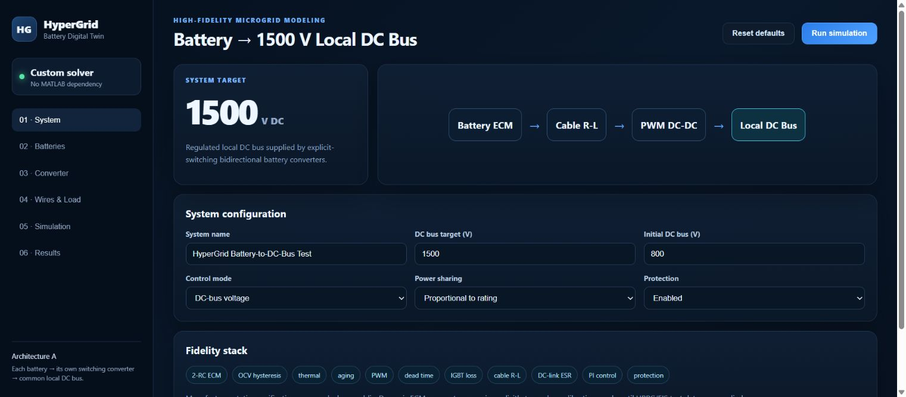
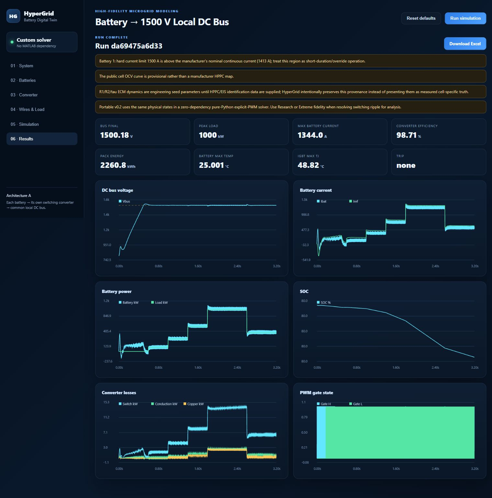

# HyperGrid lunar city and battery simulation

## City energy model

Run `python city_server.py` and open http://127.0.0.1:8012 for the new city scenario editor. The seven-node energy model, streaming datasets and Excel export are implemented; detailed whole-city physics remains in development. See [CITY_README.md](CITY_README.md) for scope and verification. The battery interface below remains separate.

## Tested screenshots

Captured from the running local application on November 7, 2026. The default simulation completed with no protection trip. Values are simulated outputs, not experimentally calibrated measurements.






HyperGrid is a standalone battery-to-local-DC-bus simulation project intended to grow into a configurable multi-microgrid data-generation platform.

## What changed in v0.2

This build is **fully portable at the Python-package level**. The previous v0.1 launcher attempted to download FastAPI, NumPy, Numba, Pydantic and XlsxWriter from PyPI. If DNS or internet access failed, the application could not start.

v0.2 removes that failure mode. It uses only the Python 3 standard library:

- no `pip install`
- no FastAPI
- no NumPy
- no Numba
- no Pydantic
- no XlsxWriter
- no MATLAB / Simulink dependency

The browser UI, simulation API, explicit PWM solver and `.xlsx` export are all included in the ZIP.

## Run on Windows

1. Extract the ZIP completely.
2. Double-click `START_HYPERGRID_WINDOWS.bat`.
3. The program starts a local server and opens `http://127.0.0.1:8000`.

Python 3.10+ is required. The user's current Python 3.13 installation is supported by this portable build.

## Current modeled subsystem

Architecture A is used: each battery owns an independent converter path into a common local DC bus.

`Battery 2-RC ECM -> cable/contactors/fuse -> explicit switching bidirectional converter -> DC-link capacitor -> local 1500 V DC bus -> constant-power load`

Current battery features include:

- real HiTHIUM 314 Ah LFP static catalog data
- configurable number of batteries
- selectable cell-architecture or direct-pack sizing
- SOC-dependent OCV lookup and slow charge/discharge hysteresis
- 2-RC polarization dynamics
- temperature- and SOC-dependent internal resistance
- SOH / throughput aging state
- lumped battery thermal state
- selectable cable material, dimensions, temperature, geometry, contactor and fuse resistance
- geometry-derived cable inductance
- explicit PWM switch state and dead time
- selectable IGBT / SiC / ideal semiconductor catalog models
- datasheet-scaled switching loss and conduction loss
- junction thermal state
- DC-bus voltage, fixed-power and fixed-current control modes
- equal, rated-power, SOC-weighted and custom sharing
- current, SOC, battery-temperature, semiconductor-temperature, bus-OV and bus-UV protections
- Excel output containing configuration, derived values, system time series, individual battery signals and source URLs

## Fidelity settings

The converter is not replaced with an averaged duty-cycle source. HyperGrid resolves PWM states directly.

For the portable pure-Python solver, the number of integration points per switching period is:

- Preview: 10
- High: 25
- Research: 50
- Extreme: 100

With the default 2 kHz switching frequency, Extreme uses a 5 microsecond electrical integration step.

Numerical resolution does not substitute for experimental calibration. R1/R2/time-constant values remain explicit engineering seed values until HPPC/EIS data are supplied and identified.

## Main files

- `app.py` — local HTTP server and application entry point
- `hypergrid/config.py` — complete default configuration and validation
- `hypergrid/simulator.py` — battery, cable, switching converter, controls, thermal and protection algorithms
- `hypergrid/exporter.py` — native `.xlsx` writer with no external library
- `data/battery_catalog.json` — cell catalog and provenance-aware ECM seeds
- `data/semiconductor_catalog.json` — IGBT / SiC / ideal device data
- `data/sources.json` — source URLs
- `static/` — frontend
- `outputs/` — generated Excel files

## Collaboration

Use a private GitHub repository as the source of truth. Both partners clone the same repository and work in branches. See `COLLABORATION.md`.

Do not use Google Colab as the sole copy of this multi-file project; Colab runtimes are temporary. Colab can still clone the GitHub repo later for experiments or dataset generation.

## Scientific limitation that is intentionally visible

The public HiTHIUM sheet provides static electrical specifications but does not provide a complete cell-specific HPPC/EIS parameter map across SOC and temperature. HyperGrid therefore labels the current dynamic ECM values as calibration seeds. The next research-grade step is an HPPC parameter-identification/import module so measured data can replace those seeds.


## Reproducible performance and export benchmark

On November 12, 2026, a synthetic software benchmark ran the default one-battery High-fidelity configuration at 3.2, 30 and 120 simulated seconds, with three repetitions per duration. The configured output interval was 0.2 ms and the integration step was 20 microseconds. The 120-second case generated **600,001 samples** and exported **600,001 data rows in each of the system and battery sheets**, with **17 columns in the battery sheet**. The real XLSX archive was CRC-checked and its XML rows counted.

[Raw repetitions, environment, source hashes and export counts](docs/benchmarks/results-20261112.json)

| Configured duration | Samples | Median simulation runtime |
|---|---:|---:|
| 3.2 seconds | 16,001 | 4.76 seconds |
| 30 seconds | 150,001 | 27.90 seconds |
| 120 seconds | 600,001 | 213.01 seconds |

The largest workbook was 110,817,038 bytes and took 111.38 seconds to export. The three 120-second runtime measurements ranged from 144.09 to 310.51 seconds, so these measurements should not be presented as a stable production throughput guarantee. They were collected on a shared Windows machine, with no hardware isolation. The actual final grid timestamp was 119.99998 seconds, one integration step below the requested horizon; this quantization is recorded explicitly. No protection trip occurred in these cases.

```powershell
python benchmarks/run.py --durations 3.2 30 120 --repeats 3
python -m unittest discover -s tests -v
```

The benchmark writes a new local `benchmark-output/` directory. The large XLSX file is not committed; its SHA-256 is recorded so regenerated files can be inspected. This is a software throughput/export benchmark, not physical validation, experimental calibration, real-world usage or a million-row completed benchmark. The original measurements used the unchanged solver/exporter from commit f0d5329; this branch additionally rejects non-finite simulation inputs and verifies the output contract in CI.
